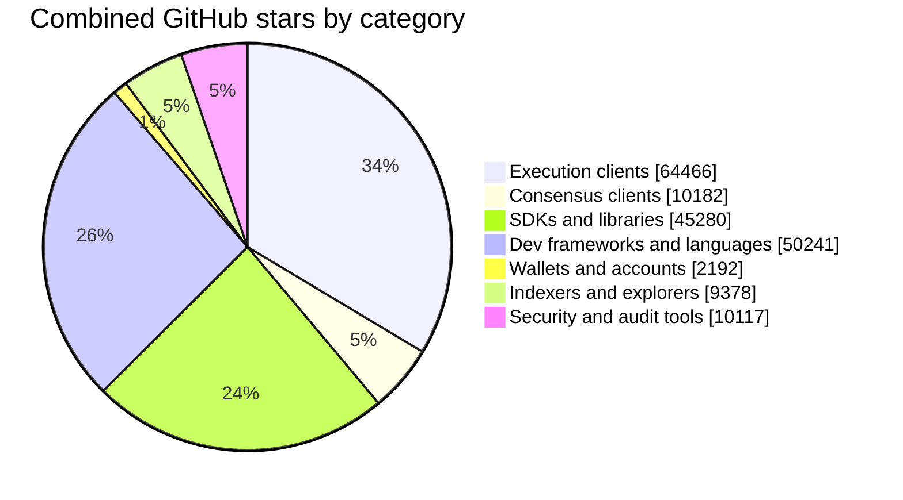

# Awesome Craft Ethereum 

> A curated list of verified open-source Ethereum clients, SDKs, dev frameworks, wallets and security tools.

Running validators, deploying contracts or using experimental tooling can put real funds at risk. This list is not investment or yield advice. Public code is not an audit.

This list is the Ethereum-specific stack. AMM and perpetual protocol source lives mainly in Awesome Craft Web3, to reduce overlap. Running a validator or deploying contracts can put real funds at risk. This list is not investment advice. Browser wallets are included only when their repository licence was checked.

## Contents

- [Dashboard](#dashboard)
- [Execution clients](#execution-clients)
- [Consensus clients](#consensus-clients)
- [SDKs and libraries](#sdks-and-libraries)
- [Dev frameworks and languages](#dev-frameworks-and-languages)
- [Wallets and accounts](#wallets-and-accounts)
- [Indexers and explorers](#indexers-and-explorers)
- [Security and audit tools](#security-and-audit-tools)
- [Related lists](#related-lists)
- [Star history](#star-history)

## Dashboard

<table>
<tr>
<td align="center"><h2>25</h2>listed projects</td>
<td align="center"><h2>7</h2>categories</td>
<td align="center"><h2>191.9k</h2>combined GitHub stars</td>
<td align="center"><h2>68.8k</h2>combined forks</td>
<td align="center"><h2>23/25</h2>pushed in the last 30 days</td>
<td align="center"><h2>11</h2>languages</td>
</tr>
</table>

**FACT** (snapshot taken 2026-11-15, GitHub API): 25 listed projects, 25 of them on GitHub with public repository statistics. Official documentation and other non-GitHub entries are listed but have no stars, forks or push dates.

**ESTIMATE**: 191.9k combined GitHub stars and 68.8k combined forks, summed from those API counts on the snapshot date. Live star badges next to GitHub entries may differ.

### 🏆 Leaderboard

<table>
<tr><th>Rank</th><th>Project</th><th>Kind</th><th align="right">Stars</th><th></th></tr>
<tr><td align="center">🥇</td><td><b>go-ethereum</b></td><td>Execution client</td><td align="right">51.5k</td><td><code>████████████████████</code></td></tr>
<tr><td align="center">🥈</td><td><b>OpenZeppelin Contracts</b></td><td>Contract library</td><td align="right">27.4k</td><td><code>███████████</code></td></tr>
<tr><td align="center">🥉</td><td><b>Solidity</b></td><td>Contract language</td><td align="right">25.8k</td><td><code>██████████</code></td></tr>
<tr><td align="center">4</td><td><b>Foundry</b></td><td>EVM toolchain</td><td align="right">10.8k</td><td><code>████</code></td></tr>
<tr><td align="center">5</td><td><b>ethers.js</b></td><td>JavaScript library</td><td align="right">8.7k</td><td><code>███</code></td></tr>
<tr><td align="center">6</td><td><b>Hardhat</b></td><td>EVM toolchain</td><td align="right">8.5k</td><td><code>███</code></td></tr>
<tr><td align="center">7</td><td><b>Slither</b></td><td>Static analysis</td><td align="right">6.4k</td><td><code>██</code></td></tr>
<tr><td align="center">8</td><td><b>Reth</b></td><td>Execution client</td><td align="right">5.9k</td><td><code>██</code></td></tr>
<tr><td align="center">9</td><td><b>web3.py</b></td><td>Python library</td><td align="right">5.5k</td><td><code>██</code></td></tr>
<tr><td align="center">10</td><td><b>Vyper</b></td><td>Contract language</td><td align="right">5.2k</td><td><code>██</code></td></tr>
</table>

### Stars by category

### Licences

     

"Custom" or "None" means GitHub could not match a standard SPDX licence, often because of extra terms or an undeclared licence. Read the project licence before you use it commercially.

## Execution clients

- [Erigon](https://github.com/erigontech/erigon) - An efficiency-oriented Ethereum execution client, formerly ledgerwatch/erigon. 
- [go-ethereum](https://github.com/ethereum/go-ethereum) - The Go Ethereum execution-layer client, commonly called Geth. The repository includes LGPL-3.0 and the GPL-3.0 text that LGPL-3 references; treat Geth as LGPL-3.0 unless a specific package says otherwise. 
- [Hyperledger Besu](https://github.com/hyperledger/besu) - An enterprise-oriented Ethereum execution client written in Java, under the Hyperledger project. 
- [Nethermind](https://github.com/NethermindEth/nethermind) - The .NET Ethereum execution-layer client. 
- [Reth](https://github.com/paradigmxyz/reth) - A Rust execution-layer client for Ethereum, dual-licensed MIT or Apache-2.0. 

## Consensus clients

- [Lighthouse](https://github.com/sigp/lighthouse) - A Rust consensus-layer client for Ethereum, maintained by Sigma Prime. 
- [Lodestar](https://github.com/ChainSafe/lodestar) - A TypeScript consensus-layer client for Ethereum, maintained by ChainSafe. 
- [Nimbus](https://github.com/status-im/nimbus-eth2) - A lightweight Ethereum consensus client from Status. 
- [Prysm](https://github.com/OffchainLabs/prysm) - An Ethereum consensus client, now under Offchain Labs (formerly prysmaticlabs/prysm). 
- [Teku](https://github.com/Consensys/teku) - A Java Ethereum consensus client from Consensys. 

## SDKs and libraries

- [ethers.js](https://github.com/ethers-io/ethers.js) - A widely used JavaScript and TypeScript library for Ethereum wallets, providers and contracts. 
- [OpenZeppelin Contracts](https://github.com/OpenZeppelin/openzeppelin-contracts) - A library of reusable Solidity contracts for tokens, access control and related patterns. This is library code, not a substitute for an audit of your own system. 
- [viem](https://github.com/wevm/viem) - A TypeScript interface for Ethereum, focused on type safety and modularity. 
- [web3.py](https://github.com/ethereum/web3.py) - A Python library for interacting with Ethereum. Confirm the current GitHub organization and licence in the repository you install. 

## Dev frameworks and languages

- [Foundry](https://github.com/foundry-rs/foundry) - A Rust-based toolchain for compiling, testing, scripting and deploying Ethereum contracts. 
- [Hardhat](https://github.com/NomicFoundation/hardhat) - A JavaScript and TypeScript contract development environment. 
- [Solidity](https://github.com/ethereum/solidity) - The Solidity compiler, solc. 
- [Vyper](https://github.com/vyperlang/vyper) - A Python-like contract language and compiler. 

## Wallets and accounts

- [Safe Smart Account](https://github.com/safe-fndn/safe-smart-account) - The Safe smart-contract account (formerly Gnosis Safe) for multi-signature self-custody. UI products and modules may have additional terms. 

## Indexers and explorers

- [Blockscout](https://github.com/blockscout/blockscout) - A self-hostable Ethereum explorer. Current versions use a source-available licence with commercial-hosting restrictions; older tags were GPL-3.0. See the Web3 list for a longer licence note. 
- [Otterscan](https://github.com/otterscan/otterscan) - A lightweight, self-hostable Ethereum explorer UI. 
- [The Graph Node](https://github.com/graphprotocol/graph-node) - A self-hostable indexer for Ethereum and other chain data via subgraphs. 

## Security and audit tools

- [Echidna](https://github.com/crytic/echidna) - A smart-contract fuzzer from Trail of Bits, used to find assertion failures and property violations. 
- [Medusa](https://github.com/crytic/medusa) - A Go Ethereum smart-contract fuzzer from Trail of Bits, related to the Echidna family of tools. 
- [Slither](https://github.com/crytic/slither) - A Solidity static analysis framework from Trail of Bits. Static analysis is not a complete audit. 

## Related lists

Other lists in the Awesome Craft series:

- [Awesome Craft](https://github.com/EdisonTKPcom/Awesome-Craft) - A curated list of open-source, self-hostable alternatives to popular SaaS tools.
- [Awesome Craft Agents](https://github.com/EdisonTKPcom/Awesome-Craft-Agents) - A curated list of open-source chat apps, coding agents, self-hosted agent bots, workflow automation and image-generation UIs.
- [Awesome Craft AI](https://github.com/EdisonTKPcom/Awesome-Craft-AI) - A curated list of open-source, self-hostable AI runtimes, servers, Hugging Face libraries and related infrastructure.
- [Awesome Craft BSC](https://github.com/EdisonTKPcom/Awesome-Craft-BSC) - A curated list of verified open-source clients, SDKs, dev tools and protocol code for BNB Smart Chain and opBNB.
- [Awesome Craft CUDA](https://github.com/EdisonTKPcom/Awesome-Craft-CUDA) - A curated list of open-source CUDA learning material, kernel libraries, tooling and portability projects.
- [Awesome Craft DeepSeek](https://github.com/EdisonTKPcom/Awesome-Craft-DeepSeek) - A curated list of official DeepSeek repositories and open-source harnesses, serving engines, eval tools and fine-tuning stacks that work with DeepSeek models.
- [Awesome Craft DevOps](https://github.com/EdisonTKPcom/Awesome-Craft-DevOps) - A curated list of open-source, self-hostable alternatives to popular DevOps and hosting SaaS tools.
- [Awesome Craft DNA](https://github.com/EdisonTKPcom/Awesome-Craft-DNA) - A curated list of open-source tools for DNA, genomics and synthetic biology.
- [Awesome Craft EV](https://github.com/EdisonTKPcom/Awesome-Craft-EV) - A curated list of open-source software and hardware for electric vehicles and charging.
- [Awesome Craft Hardware](https://github.com/EdisonTKPcom/Awesome-Craft-Hardware) - A curated list of open-source tools for PCB, FPGA, ASIC and chip design.
- [Awesome Craft Hyperliquid](https://github.com/EdisonTKPcom/Awesome-Craft-Hyperliquid) - A curated list of verified open-source SDKs, node tools, analytics and community libraries for the Hyperliquid ecosystem.
- [Awesome Craft Jarvis](https://github.com/EdisonTKPcom/Awesome-Craft-Jarvis) - A curated list of open-source tools to run a personal JARVIS-style AI assistant locally, including dashboards, agent runtimes, voice, MCP connections and memory.
- [Awesome Craft Malaysia](https://github.com/EdisonTKPcom/Awesome-Craft-Malaysia) - A curated list of open-source tools useful to Malaysian SMEs, with verified MyInvois support called out separately.
- [Awesome Craft Mars](https://github.com/EdisonTKPcom/Awesome-Craft-Mars) - A curated list of open-source tools and open data for Mars missions and settlement planning.
- [Awesome Craft Neuro](https://github.com/EdisonTKPcom/Awesome-Craft-Neuro) - A curated list of open-source tools for brain-computer interfaces, electrophysiology and neurotechnology.
- [Awesome Craft Robotics](https://github.com/EdisonTKPcom/Awesome-Craft-Robotics) - A curated list of open-source robotics software and hardware, including Microduck, Unitree SDKs, open humanoids, arms, simulation and middleware.
- [Awesome Craft Solana](https://github.com/EdisonTKPcom/Awesome-Craft-Solana) - A curated list of verified open-source Solana clients, SDKs, frameworks, explorers and program libraries.
- [Awesome Craft Space](https://github.com/EdisonTKPcom/Awesome-Craft-Space) - A curated list of open-source tools for spaceflight and rockets, covering orbit simulation, telemetry, launch data and more.
- [Awesome Craft Starlink](https://github.com/EdisonTKPcom/Awesome-Craft-Starlink) - A curated list of open-source tools for Starlink and other LEO satellite internet systems.
- [Awesome Craft Web3](https://github.com/EdisonTKPcom/Awesome-Craft-Web3) - A curated list of open-source DEX protocol code, self-custody software, indexers, frameworks and Blockchain infrastructure.

## Star history

## Contributing

Contributions welcome! Read the [contribution guidelines](contributing.md) first.

If this list is useful, give it a ⭐ so others can find it.

